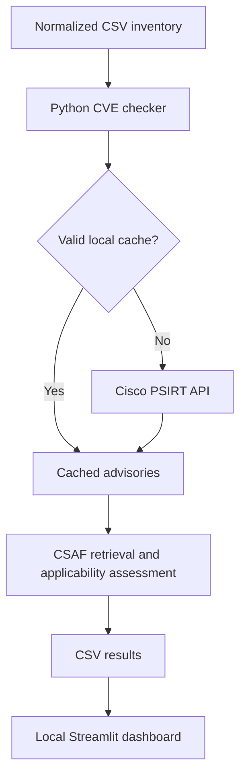

# CVEFinder

Cisco network device vulnerability discovery and assessment tool, built with Python and Streamlit.

## Overview

CVEFinder automates the discovery of security advisories for Cisco network equipment using an existing inventory of device models and firmware versions. It integrates with the Cisco PSIRT openVuln API and uses Common Security Advisory Framework (CSAF) documents, when available, to assess vulnerability applicability.

The project aims to reduce manual vulnerability research, support network security audits and help prioritize remediation. It provides a local interactive dashboard without requiring a database or an external dashboard service.

## Features

- OAuth 2.0 client credentials authentication and automatic token renewal.
- Advisory discovery by normalized Cisco product family or supported operating system version.
- Alternative product name queries and advisory deduplication.
- Paginated API requests, request throttling and retries for transient HTTP errors.
- Local JSON cache with a 24-hour lifetime for queries and CSAF documents.
- Conservative model and firmware matching against explicit CSAF product statuses.
- CSV export with CVE identifiers, severity, CVSS, advisory links and assessment evidence.
- Interactive Streamlit dashboard with filters, charts, per-device summaries and data-quality reporting.

## Architecture



The checker queries public advisory information; it does not connect to switches, collect their configuration, exploit vulnerabilities or install firmware updates.

## Project structure

```text
CVEFinder/
├── cisco_cve_checker.py       # Advisory discovery and assessment
├── cve_dashboard.py           # Local visualization
├── cisco_inventory.csv        # Normalized inventory (private)
├── requirements.txt           # Python dependencies
├── .env                       # API credentials (private)
├── .gitignore
├── README.md
├── cisco_cve_cache.json       # Generated cache
└── cve_results.csv            # Generated assessment results
```

## Installation

### 1. Prerequisites

- Python 3 with a version supported by the dependencies
- Internet access to Cisco authentication, advisory and CSAF endpoints
- A Cisco API application with PSIRT openVuln access
- A normalized inventory CSV

### 2. Create a virtual environment

Windows PowerShell:

```powershell
python -m venv .venv
.\.venv\Scripts\Activate.ps1
```

Linux/macOS:

```bash
python3 -m venv .venv
source .venv/bin/activate
```

### 3. Install dependencies

Create a `requirements.txt` file containing:

```text
requests
python-dotenv
urllib3
pandas
streamlit
```

Install the dependencies:

```bash
python -m pip install -r requirements.txt
```

## Cisco API configuration

1. Sign in to the [Cisco API Console](https://apiconsole.cisco.com/).
2. Register an application with access to the PSIRT openVuln API and the client credentials grant.
3. Obtain its Client ID and Client Secret.
4. Create a `.env` file in the project directory:

```dotenv
CISCO_CLIENT_ID=your_client_id
CISCO_CLIENT_SECRET=your_client_secret
```

The checker retrieves access tokens automatically. Do not commit credentials or tokens to source control.

## Inventory format

The input is a normalized CSV, not a raw list of IP addresses. The following fictional example illustrates the expected format:

```csv
id,hostname,model,firmware,vendor,product_family,cisco_product_name,cisco_resource_id,cisco_product_name_alt,cisco_resource_id_alt,os_type,query_method,mapping_status
1,example-switch,WS-C2960X-48FPS-L,15.2(4)E7,Cisco,Catalyst 2960X,IOS,2097,,,ios,os_version,catalog_match_unverified
```

| Field | Description |
| --- | --- |
| `id` | Unique device identifier |
| `hostname` | Device hostname |
| `model` | Exact hardware model |
| `firmware` | Installed firmware version |
| `product_family` | Normalized product family |
| `cisco_product_name` | Primary Cisco advisory search name |
| `cisco_product_name_alt` | Optional alternative search name; column required |
| `os_type` | Cisco OS identifier for OS-version queries; column required |
| `query_method` | `product` or `os_version` |
| `mapping_status` | Product mapping confidence/status |
| `vendor`, `cisco_resource_id`, `cisco_resource_id_alt` | Optional metadata; not used to construct API requests |

The product name, not the resource ID, is used for product queries. Validate mappings against the Cisco product catalog before relying on results. Preserve firmware versions exactly as reported by the device.

The original checker distribution uses `cisco_inventory_updated.csv`. If your inventory is named `cisco_inventory.csv`, set the following in `cisco_cve_checker.py`:

```python
INPUT = ROOT / 'cisco_inventory.csv'
```

## Usage

### 1. Run the vulnerability checker

From the project directory, with the virtual environment activated:

```bash
python cisco_cve_checker.py
```

The checker loads the inventory, retrieves or reuses cached advisories, evaluates available CSAF evidence and exports `cve_results.csv`. It also retains a result row for devices with no matching advisory or an unsuccessful scan.

### 2. Launch the dashboard

```bash
python -m streamlit run cve_dashboard.py --server.address 127.0.0.1
```

Open <http://127.0.0.1:8501> in your browser.

The dashboard reads `cve_results.csv` from the project directory by default. An alternative CSV can be uploaded through the sidebar.

| Tab | Purpose |
| --- | --- |
| Overview (Visão geral) | Metrics, severity charts and devices with the most candidate CVEs |
| Devices (Equipamentos) | Per-device summaries and detailed findings |
| Vulnerabilities (Vulnerabilidades) | CVE details, CVSS, evidence, advisory links and filtered CSV export |
| Data quality (Qualidade dos dados) | Partial scans, failed queries and uncertain mappings in the original dataset |

Filters include device, model, firmware, severity, applicability and scan status. Search by CVE identifier, advisory identifier or title. Metrics distinguish unique CVEs from device–CVE pairs. The current dashboard interface is in Portuguese.

### 3. Refresh results

Run the checker again and select **Recarregar dados** in the dashboard. To force fresh API and CSAF retrieval before the cache expires, delete `cisco_cve_cache.json` while the checker is not running, then rerun it. The dashboard reload alone does not query the Cisco API.

## Understanding the results

| Vulnerability status | Meaning |
| --- | --- |
| `VULNERABLE` | Explicit model and firmware match in CSAF `known_affected`; exploitation prerequisites still require review |
| `POTENTIALLY_VULNERABLE` | Candidate advisory; applicability could not be established unambiguously |
| `NOT_AFFECTED` | Explicit matching CSAF evidence indicates the version is not affected or is fixed for this CVE |
| `NO_MATCHES_FOUND` | Successful query without matching advisories; not proof of security |
| `UNKNOWN` | Insufficient information, uncertain mapping or failed discovery |

Scan status is reported separately:

- `COMPLETE`: planned advisory queries succeeded and no attempted CSAF retrieval failed.
- `PARTIAL`: some queries or CSAF retrievals failed.
- `SCAN_ERROR`: query construction or all planned advisory queries failed.

A complete scan is not a guarantee of complete vulnerability coverage. Review `match_reason`, `query_errors`, `mapping_status` and official advisory links before making remediation decisions.

## Security and privacy

Keep real inventories, credentials, generated reports and cached data out of public repositories. Run the dashboard on localhost unless appropriate authentication and access controls are implemented.

Suggested `.gitignore`:

```gitignore
.venv/
venv/
__pycache__/
*.pyc
.env
.env.*
!.env.example
cisco_inventory*.csv
cve_results*.csv
cisco_cve_cache.json
*.tmp
```

The checker sends product names and OS versions to Cisco as part of advisory discovery. Hostnames and device IDs remain in the local inventory and reports. The dashboard does not make advisory API requests. Publish only sanitized, synthetic example data if needed.

## Troubleshooting

| Problem | Action |
| --- | --- |
| `FileNotFoundError` | Check the inventory filename and its location next to the checker. |
| `invalid_client` / HTTP 401 | Verify the API application credentials and access permissions. |
| `PRODUCT_NOT_FOUND` | Verify the exact Cisco catalog product name and alternative mappings. Do not interpret this as zero vulnerabilities. |
| HTTP 429 | Respect rate limits and reuse the cache; inspect errors if retries are exhausted. |
| Missing CSV columns | Use the normalized inventory schema, not the original unnormalized export. |
| Dashboard cannot load results | Run the checker first or upload a compatible results CSV. |

## Current limitations

- Cisco-only advisory integration; other vendors are not currently supported.
- Product-family queries may return advisories that do not apply to an individual device.
- CSAF matching uses explicit model and firmware names; complex version ranges, product relationships and configuration-dependent conditions are not fully evaluated.
- CVSS and severity are taken from advisory-level metadata and may not represent every individual CVE precisely.
- The `fixed_version` field is not a general upgrade recommendation; the current implementation only populates it for explicit matching fixed-version evidence.
- Results depend on Cisco advisory coverage, catalog mappings and the accuracy of the inventory. End-of-life products may have incomplete coverage or no available fixes.
- This tool supports vulnerability assessment, not active vulnerability scanning or automatic remediation.

## Roadmap

- [x] Cisco PSIRT API integration
- [x] Normalized CSV inventory and product mapping
- [x] Local caching and CSV reports
- [x] Explicit CSAF applicability checks
- [x] Interactive Streamlit dashboard
- [ ] More comprehensive CSAF product relationship and version-range resolution
- [ ] NVD/CPE enrichment and multi-vendor support
- [ ] CISA KEV and EPSS enrichment
- [ ] End-of-life and security support tracking
- [ ] Automated tests and reproducible assessment fixtures
- [ ] Integration with network inventory and switch auditing workflows

## References

- [Cisco PSIRT openVuln API documentation](https://developer.cisco.com/docs/psirt/)
- [Cisco API Console](https://apiconsole.cisco.com/)
- [Cisco Security Advisories](https://sec.cloudapps.cisco.com/security/center/publicationListing.x)
- [OASIS CSAF standard](https://docs.oasis-open.org/csaf/csaf/v2.0/csaf-v2.0.html)
- [Streamlit documentation](https://docs.streamlit.io/)

## Disclaimer

CVEFinder is intended for defensive security assessment and authorized network administration. Its findings should be validated against official vendor advisories and actual device configurations before remediation decisions are made.
